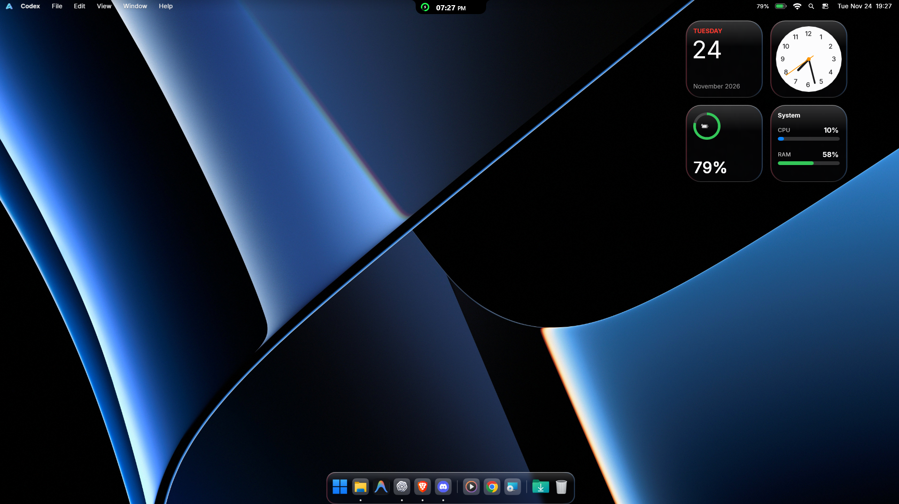
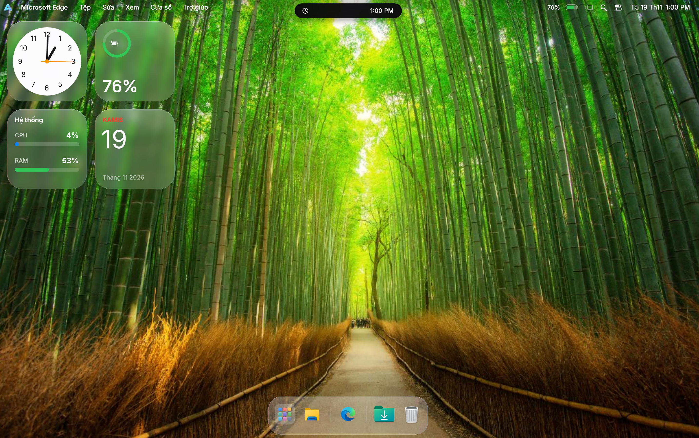
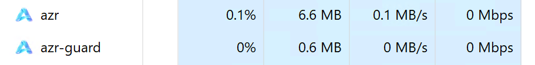

<h1>Azr</h1>

Desktop customization for Windows 11.

[English](README.md) · [Tiếng Việt](README.vi.md)

Azr is a desktop customization app for **Windows 11**, inspired by macOS. It adds a Dock, Dynamic Island, menu bar, quick controls, and desktop widgets, with appearance settings you can adjust to suit your workflow. Available in English and Vietnamese.

**[Download the latest release](https://github.com/Ericismee/Azr/releases/latest)** · [Share your desktop](https://github.com/Ericismee/Azr/discussions/3) · [Screenshots](#screenshots) · [Tiếng Việt](README.vi.md)

## Main features

- **Dock and Launchpad:** Access frequently used apps, browse your applications, and open Downloads or Recycle Bin. Customize icon appearance and enable magnification on hover.
- **Dynamic Island:** View the clock and access music controls, a timer, and a file shelf. Expand the panel to interact with it, then return it to a compact view.
- **Menu bar and quick controls:** View system status and access sound, display, and connectivity controls. Arrange the controls around the settings you use most.
- **Desktop widgets:** Keep a clock, calendar, battery status, and system usage visible on your desktop.
- **Search and window tools:** Find applications, switch between windows, and assign actions to screen corners.
- **Appearance customization:** Choose light or dark themes, glass surfaces, transparency, colors, and icon styles. Adjust the Dock, icon corners, and menu logo using a built-in symbol or your own image.

## Screenshots

*What does Azr look like on your desktop? [Share your setup](https://github.com/Ericismee/Azr/discussions/3).*

Explore the desktop, glass controls, and widgets

Captured in Windows Sandbox, showing several appearance configurations. Glass effects may vary with wallpaper, Windows settings, hardware, and remote-session support.

## Resource usage

In this Task Manager snapshot, Azr shows **6.6 MB** of memory and **0.1% CPU**, while its recovery companion shows **0.6 MB** and **0% CPU**—about **7.2 MB combined at that moment**. This is a single observation, not a benchmark or a fixed requirement. Usage changes with your setup and activity, and the displayed figures do not include every graphics or system memory cost. Download size is separate from runtime RAM.

## Download and run

Use the installer for your edition of Windows. These links follow the [latest stable release](https://github.com/Ericismee/Azr/releases/latest).

- **[Windows 11 x64 installer](https://github.com/Ericismee/Azr/releases/latest/download/Azr-Setup-Windows11-x64.exe)** is the recommended download for Windows 11.
- **[Windows 10 22H2 x64 installer](https://github.com/Ericismee/Azr/releases/latest/download/Azr-Setup-Windows10-x64.exe)** is a compatibility preview for build 19045. Testing on Windows 10 itself is still pending.
- **[Portable ZIP for x64](https://github.com/Ericismee/Azr/releases/latest/download/Azr-Windows-x64-Portable.zip)** contains both executables, DLLs, fonts, and branding. Extract the whole archive before opening `azr.exe`.

The installers include the required Visual C++ DLLs and install for the current user in `%LOCALAPPDATA%\Programs\Azr`. All packages target x64 Intel and AMD systems. The executables are unsigned. Use [`SHA256SUMS.txt`](https://github.com/Ericismee/Azr/releases/latest/download/SHA256SUMS.txt) to verify your download. See the [build guide](docs/BUILD.md) for source builds.

## Configuration and privacy

Autostart, taskbar takeover, clipboard history, online lyrics, and local file sharing are **off by default**. Your settings live in `%APPDATA%\Azr`. The companion process helps restore the taskbar when takeover is enabled and Azr stops unexpectedly.

Online lyrics use an external service. Local file sharing uses unencrypted HTTP and should only be enabled on a trusted network. For a first trial, Windows Sandbox is a convenient option. Uninstall the Setup version through Windows Settings → Apps → Installed apps → Azr. For the portable version, disable autostart, exit the app, and delete the extracted folder. Remove the profile separately if you also want to erase settings.

## Feedback and contributions

Share a screenshot and your favorite settings in the [Desktop Showcase](https://github.com/Ericismee/Azr/discussions/3). Join [Discussions](https://github.com/Ericismee/Azr/discussions) for questions and ideas, or open an [Issue](https://github.com/Ericismee/Azr/issues) to report a reproducible bug.

If Azr has earned a place on your desktop, consider starring the repository so you can find it again.

## License

[PolyForm Noncommercial 1.0.0](LICENSE.md) · [Third-party components](legal/THIRD-PARTY-LICENSES.md)

Azr is an independent Windows project, not affiliated with Apple or Microsoft. Its glass effects are implemented for Windows.

  

