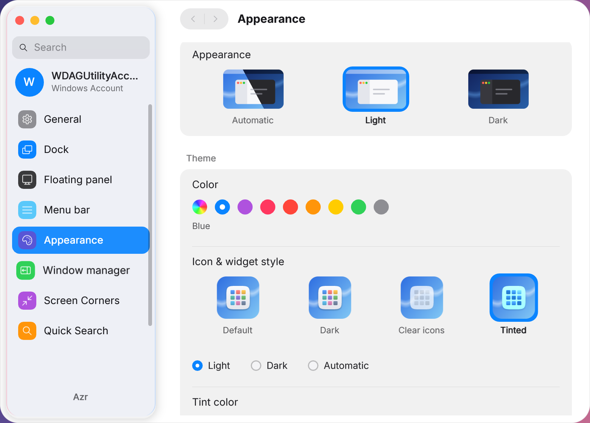
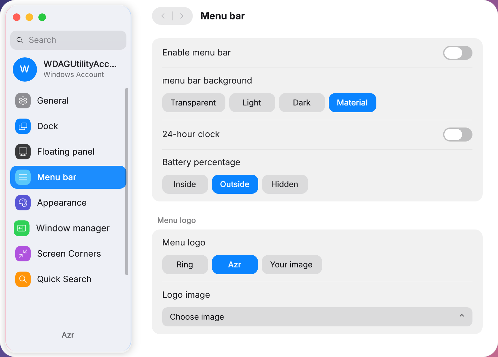

<div align="center">

<h1>Azr</h1>
<p>A personal desktop, shaped around you.</p>

[English](README.md) · [Tiếng Việt](README.vi.md)

[](https://github.com/Ericismee/Azr/actions/workflows/ci.yml)
[](https://github.com/Ericismee/Azr/stargazers)
[](https://github.com/Ericismee/Azr/forks)

[](LICENSE.md)
</div>

Azr is a native Windows 11 desktop customization app written in Rust. Bring together a magnifying Dock, a menu bar, floating controls, and continuously rounded icons in a glass-inspired interface. Available in English and Vietnamese.


## Make it yours

- **Dock:** app shortcuts, magnification, Launchpad, Downloads, and Recycle Bin.
- **Surfaces:** glass, frosted, transparent, or solid; separate opacity and blur controls.
- **Icons:** optional backgrounds, adjustable continuous corners, and color styles.
- **Workspace:** menu bar, quick controls, hot corners, window tools, and desktop widgets.
- **Identity:** choose the Azr symbol, a circular ring, or import your own menu logo.
- **Language and scale:** English and Vietnamese, with wrapped labels and adaptable settings layouts.

The glass and corner effects are Azr's Windows implementation. Rendering depends on Windows transparency settings, hardware, power mode, and remote-session support.

<p align="center"></p>

## Build and run

Requirements: Windows 11 x64, stable Rust, Visual Studio C++ x64 Build Tools, and the Windows SDK.

```powershell
git clone https://github.com/Ericismee/Azr.git
cd Azr
.uild.ps1
```

The script runs the locked workspace tests, builds release binaries, and creates a portable ZIP with SHA-256 hashes in `dist`. It does not launch or install the app. Extract the package and open `azr.exe`; keep `azr-guard.exe`, `fonts`, and `brand` alongside it. Normal use does not require administrator privileges. Exit through the app menu or notification area.

```powershell
cargo fmt --all -- --check
cargo test --locked --workspace
```

## Customize

Open **Settings → Dock** for surface material, opacity, blur, icon backgrounds, and corner shape. **Appearance** controls themes and icon colors. **Menu bar** includes the logo selector and image picker. Logo imports are limited to 8 MiB and 16 million decoded pixels; an invalid image leaves the previous logo intact.

<p align="center"></p>

## Privacy and safety

Autostart, taskbar takeover, clipboard history, online lyrics, and local-network file sharing are disabled by default. Configuration stays in `%APPDATA%\Azr`; set `AZR_CONFIG_DIR` to use another profile directory.

Enabling online lyrics connects to LRCLIB over HTTPS. Enabling local file sharing uses unencrypted HTTP with random, time-limited links: use it only on a trusted network. The companion guard helps restore the Windows taskbar if takeover is enabled and the app exits unexpectedly. Tests and antivirus scans cannot guarantee the absence of every security issue. For a first trial, use Windows Sandbox.

## Project map

- `crates/app`: application windows, settings, and desktop integration.
- `crates/core`: configuration, layout, rendering logic, and unit tests.
- `crates/platform`: Windows APIs and services.
- `crates/ui`: graphics and composition.
- `crates/guard`: taskbar recovery companion.
- `assets/brand`: original Azr artwork and symbol.

## Community interest

Stars and forks above are live GitHub counters. This is a new repository; history may be empty until real activity appears. The chart reflects recorded stars, without projected growth.

[](https://www.star-history.com/#Ericismee/Azr&Date)

## License

Distributed under [PolyForm Noncommercial 1.0.0](LICENSE.md). Commercial use is not granted by that license. Font and dependency information is in [Third-party components](legal/THIRD-PARTY-LICENSES.md). Azr is an independent Windows project and is not affiliated with Apple or Microsoft.
