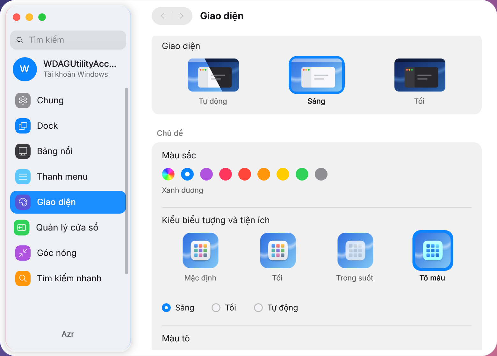

<div align="center">

<h1>Azr</h1>
<p>A personal desktop, shaped around you.</p>

[English](README.md) · [Tiếng Việt](README.vi.md)

[](https://github.com/Ericismee/Azr/actions/workflows/ci.yml)
[](https://github.com/Ericismee/Azr/stargazers)
[](https://github.com/Ericismee/Azr/forks)

[](LICENSE.md)
</div>

Azr là ứng dụng tùy biến màn hình nền Windows 11, viết bằng Rust. Dock phóng to, thanh menu, bảng điều khiển nổi và biểu tượng bo liên tục được kết hợp trong giao diện lấy cảm hứng từ kính. Hỗ trợ tiếng Việt và tiếng Anh.


## Tùy biến theo cách của bạn

- **Dock:** lối tắt ứng dụng, hiệu ứng phóng to, Launchpad, Tải xuống và Thùng rác.
- **Chất liệu:** kính, kính mờ, trong suốt hoặc đặc; chỉnh riêng độ đục và độ mờ.
- **Biểu tượng:** bật hoặc tắt nền, điều chỉnh góc bo liên tục và kiểu màu.
- **Không gian làm việc:** thanh menu, điều khiển nhanh, góc nóng, công cụ cửa sổ và tiện ích.
- **Logo:** chọn biểu tượng Azr, vòng tròn hoặc tải ảnh của bạn lên.
- **Hiển thị:** hai ngôn ngữ, nhãn tự xuống dòng và bố cục cài đặt thích ứng.

Hiệu ứng kính và góc bo được Azr dựng trên Windows. Kết quả phụ thuộc thiết lập trong suốt, phần cứng, chế độ tiết kiệm pin và phiên làm việc từ xa.

<p align="center"></p>

## Build và chạy

Cần Windows 11 x64, Rust stable, Visual Studio Build Tools có công cụ C++ x64 và Windows SDK.

```powershell
git clone https://github.com/Ericismee/Azr.git
cd Azr
.uild.ps1
```

Script chạy kiểm thử với dependency đã khóa, build release và tạo ZIP portable kèm SHA-256 trong `dist`. Script không tự mở hay cài ứng dụng. Giải nén rồi mở `azr.exe`; giữ `azr-guard.exe`, `fonts` và `brand` bên cạnh. Cách chạy thông thường không cần quyền quản trị. Thoát bằng menu ứng dụng hoặc biểu tượng khay hệ thống.

```powershell
cargo fmt --all -- --check
cargo test --locked --workspace
```

## Thiết lập giao diện

Vào **Cài đặt → Dock** để chỉnh chất liệu, độ đục, độ mờ, nền và góc bo biểu tượng. Trang **Giao diện** có chủ đề và kiểu màu. Trang **Thanh menu** có lựa chọn logo và nút chọn ảnh. Ảnh nhập tối đa 8 MiB và 16 triệu điểm ảnh sau giải mã; ảnh không hợp lệ không thay thế logo đang dùng.

<p align="center"></p>

## Quyền riêng tư và an toàn

Mặc định tắt tự khởi động, thay thế thanh tác vụ, lịch sử bảng nhớ tạm, lời bài hát trực tuyến và chia sẻ tệp nội bộ. Cấu hình lưu tại `%APPDATA%\Azr`; dùng biến `AZR_CONFIG_DIR` nếu muốn đổi thư mục hồ sơ.

Khi bật lời bài hát trực tuyến, ứng dụng kết nối LRCLIB qua HTTPS. Chia sẻ tệp nội bộ dùng HTTP không mã hóa với liên kết ngẫu nhiên, giới hạn thời gian; chỉ dùng trên mạng tin cậy. Tiến trình guard hỗ trợ khôi phục thanh tác vụ khi bật chế độ thay thế và ứng dụng dừng bất thường. Kiểm thử và quét chống mã độc không bảo đảm an toàn tuyệt đối. Nên thử lần đầu bằng Windows Sandbox.

## Cấu trúc dự án

- `crates/app`: cửa sổ ứng dụng, cài đặt và tích hợp màn hình nền.
- `crates/core`: cấu hình, bố cục, logic vẽ và kiểm thử.
- `crates/platform`: API và dịch vụ Windows.
- `crates/ui`: đồ họa và hiệu ứng.
- `crates/guard`: tiến trình hỗ trợ khôi phục thanh tác vụ.
- `assets/brand`: logo và biểu tượng Azr.

## Mức độ quan tâm

Huy hiệu phía trên lấy số sao và fork trực tiếp từ GitHub. Repo mới nên biểu đồ có thể chưa có dữ liệu. Biểu đồ chỉ hiển thị số sao được ghi nhận, không dự đoán tăng trưởng.

[](https://www.star-history.com/#Ericismee/Azr&Date)

## Giấy phép

Phân phối theo [PolyForm Noncommercial 1.0.0](LICENSE.md); giấy phép này không cấp quyền sử dụng thương mại. Xem thông tin font và thư viện tại [Thành phần bên thứ ba](legal/THIRD-PARTY-LICENSES.md). Azr là dự án độc lập dành cho Windows, không liên kết với Apple hay Microsoft.
