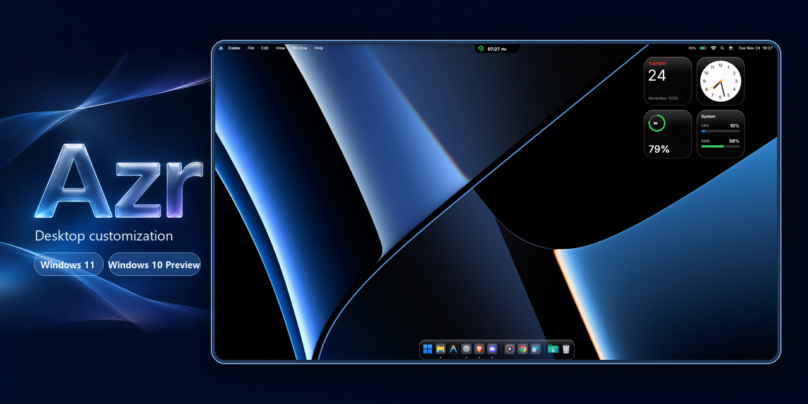

<h1>Azr</h1>

Tùy biến giao diện Windows 11.

[English](README.md) · [Tiếng Việt](README.vi.md)

Azr là ứng dụng tùy biến giao diện dành cho **Windows 11**, lấy cảm hứng từ macOS. Ứng dụng bổ sung Dock, Dynamic Island, thanh menu, bảng điều khiển nhanh và widget, đồng thời cho phép điều chỉnh giao diện theo nhu cầu sử dụng. Azr hỗ trợ tiếng Việt và tiếng Anh.

**[Tải bản mới nhất](https://github.com/Ericismee/Azr/releases/latest)** · [Ảnh giao diện](#ảnh-giao-diện) · [English](README.md) · [Khoe desktop của bạn](https://github.com/Ericismee/Azr/discussions/3)

## Tính năng chính

- **Dock và Launchpad:** Truy cập ứng dụng thường dùng, xem danh sách ứng dụng, mở thư mục Tải xuống và Thùng rác. Dock hỗ trợ phóng to khi rê chuột và tùy chỉnh cách hiển thị biểu tượng.
- **Dynamic Island:** Hiển thị đồng hồ và cung cấp không gian tương tác với nhạc, hẹn giờ và tệp. Bảng có thể mở rộng để thao tác rồi thu gọn khi không sử dụng.
- **Thanh menu và điều khiển nhanh:** Theo dõi trạng thái hệ thống, truy cập các điều khiển âm thanh, hiển thị và kết nối. Có thể sắp xếp các điều khiển theo thói quen sử dụng.
- **Widget màn hình nền:** Đặt đồng hồ, lịch, thông tin pin và mức sử dụng hệ thống trên desktop để theo dõi trực tiếp.
- **Tìm kiếm và quản lý cửa sổ:** Tìm ứng dụng, chuyển đổi cửa sổ và thiết lập hành động cho các góc màn hình.
- **Tùy chỉnh giao diện:** Chọn chủ đề sáng hoặc tối, chất liệu kính, độ trong suốt, màu sắc và kiểu biểu tượng. Điều chỉnh hình dáng Dock, góc bo biểu tượng và logo trên thanh menu bằng biểu tượng có sẵn hoặc ảnh riêng.

## Ảnh giao diện

*Bạn tùy biến Azr thế nào? [Chia sẻ ảnh desktop của bạn](https://github.com/Ericismee/Azr/discussions/3).*

Xem màn hình nền, bảng điều khiển kính và widget

Ảnh chụp trong Windows Sandbox, minh họa một số cấu hình giao diện. Hiệu ứng kính có thể khác nhau theo hình nền, thiết lập Windows, phần cứng và phiên làm việc từ xa.

## Mức sử dụng tài nguyên

Trong ảnh Task Manager này, Azr hiển thị **6,6 MB** bộ nhớ và **0,1% CPU**; tiến trình hỗ trợ khôi phục hiển thị **0,6 MB** và **0% CPU**—tổng khoảng **7,2 MB tại lúc chụp**. Đây là một lần quan sát, không phải benchmark hay yêu cầu cố định. Mức dùng thay đổi theo cấu hình và hoạt động; số hiển thị không bao gồm mọi chi phí bộ nhớ đồ họa hoặc hệ thống. Dung lượng tải về khác với RAM khi chạy.

## Tải và sử dụng

Chọn bộ cài theo phiên bản Windows đang dùng. Các liên kết luôn trỏ đến [bản chính thức mới nhất](https://github.com/Ericismee/Azr/releases/latest).

- **[Bộ cài Windows 11 x64](https://github.com/Ericismee/Azr/releases/latest/download/Azr-Setup-Windows11-x64.exe)** dành cho người dùng Windows 11.
- **[Bộ cài Windows 10 22H2 x64](https://github.com/Ericismee/Azr/releases/latest/download/Azr-Setup-Windows10-x64.exe)** là bản thử tương thích cho build 19045. Vẫn cần kiểm thử trên Windows 10 thật.
- **[Bản portable x64](https://github.com/Ericismee/Azr/releases/latest/download/Azr-Windows-x64-Portable.zip)** gồm hai EXE, DLL, font và logo. Giải nén toàn bộ ZIP rồi mở `azr.exe`.

Hai bộ cài có sẵn các DLL Visual C++ cần thiết và cài cho tài khoản hiện tại tại `%LOCALAPPDATA%\Programs\Azr`. Các gói dành cho máy Intel hoặc AMD x64. EXE chưa được ký số. Dùng [`SHA256SUMS.txt`](https://github.com/Ericismee/Azr/releases/latest/download/SHA256SUMS.txt) để đối chiếu tệp tải về. Xem [hướng dẫn tự build](docs/BUILD.md).

## Cấu hình và quyền riêng tư

Tự khởi động, thay thế thanh tác vụ, lịch sử bảng nhớ tạm, lời bài hát trực tuyến và chia sẻ tệp nội bộ đều **mặc định tắt**. Thiết lập lưu tại `%APPDATA%\Azr`. Tiến trình đi kèm hỗ trợ khôi phục thanh tác vụ khi bật chế độ thay thế và Azr dừng bất thường.

Lời bài hát trực tuyến dùng dịch vụ bên ngoài. Chia sẻ tệp nội bộ dùng HTTP không mã hóa, nên chỉ bật trên mạng tin cậy. Bạn có thể thử lần đầu trong Windows Sandbox. Để gỡ bản cài đặt, dùng Settings → Apps → Installed apps → Azr của Windows. Với bản portable, tắt tự khởi động, thoát ứng dụng rồi xóa thư mục giải nén. Xóa riêng hồ sơ nếu muốn bỏ cả thiết lập.

## Phản hồi và đóng góp

Đăng ảnh và chia sẻ cách tùy biến trong mục [Khoe desktop Azr](https://github.com/Ericismee/Azr/discussions/3). Bạn có thể đặt câu hỏi và góp ý tại [Discussions](https://github.com/Ericismee/Azr/discussions) hoặc mở [Issue](https://github.com/Ericismee/Azr/issues) để báo lỗi có thể tái hiện.

Nếu bạn thích dùng Azr, hãy tặng repo một sao để dễ tìm lại trên GitHub.

## Giấy phép

[PolyForm Noncommercial 1.0.0](LICENSE.md) · [Thành phần bên thứ ba](legal/THIRD-PARTY-LICENSES.md)

Azr là dự án độc lập dành cho Windows, không liên kết với Apple hay Microsoft. Hiệu ứng kính được triển khai riêng trên Windows.

  

