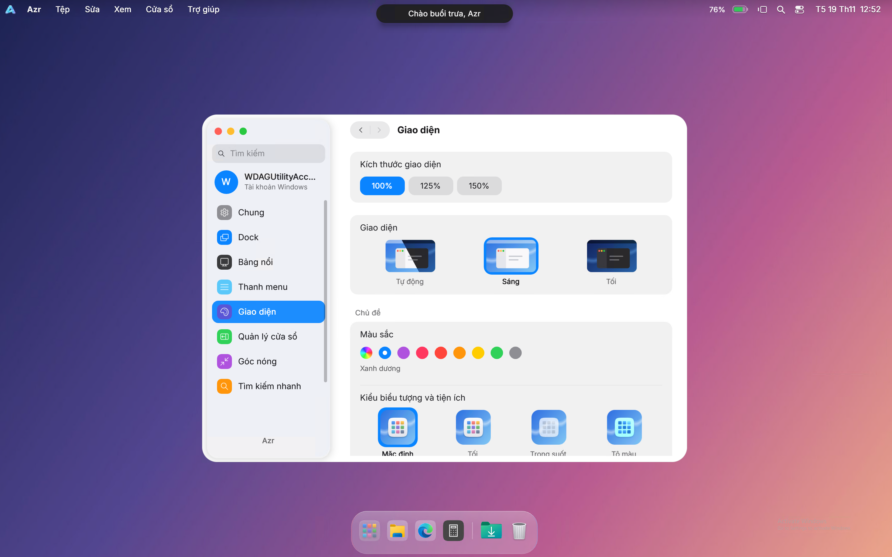
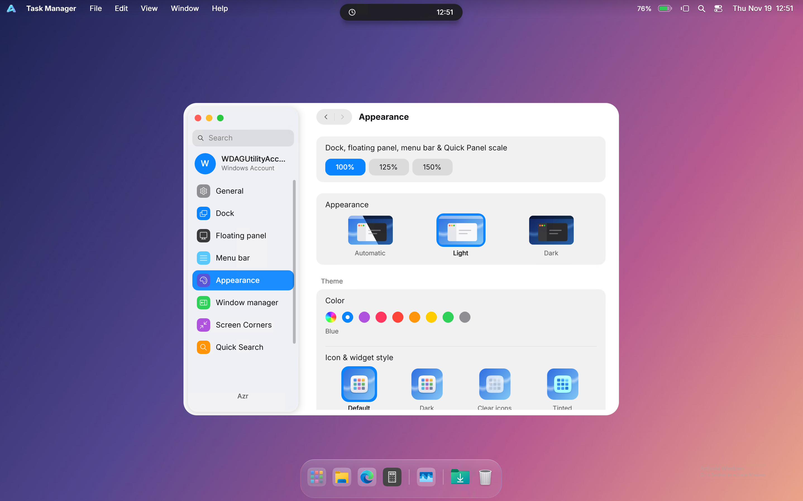
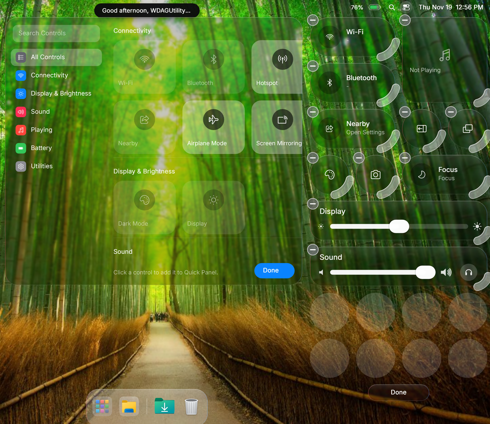
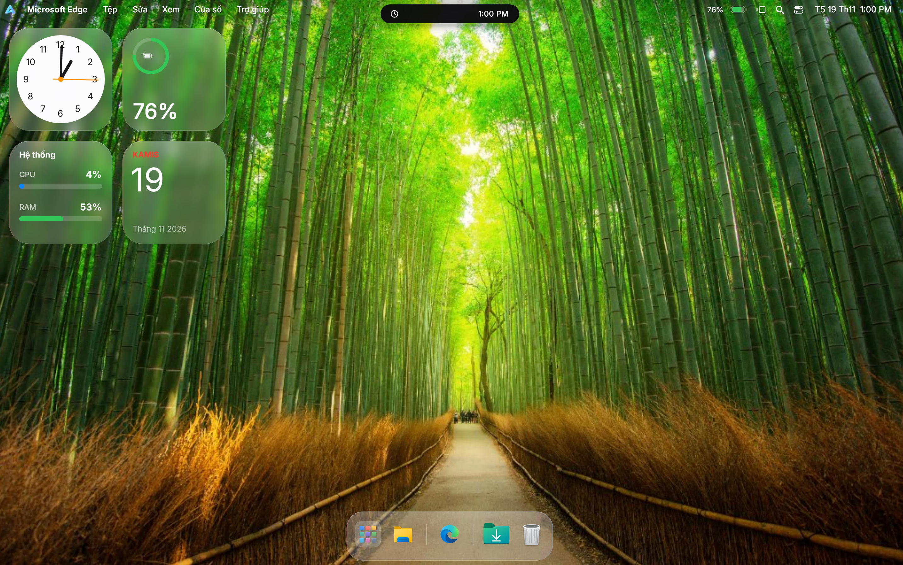
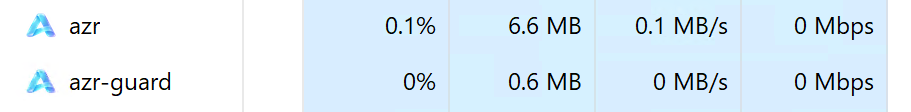

<h1>Azr</h1>

Một góc Windows, mang dấu ấn của bạn.

[English](README.md) · [Tiếng Việt](README.vi.md)

Mỗi lần mở máy là một lần trở về không gian của bạn. Hãy làm cho nơi ấy đáng mong chờ hơn một chút.

**Azr mang cảm hứng macOS đến Windows 11** qua Dock kính, Island linh hoạt, thanh menu và các bảng điều khiển đồng điệu. Vẫn là những ứng dụng quen thuộc, nhưng màn hình nền có thêm nét riêng của bạn.

**[Tải Azr](https://github.com/Ericismee/Azr/releases/latest)** · [Ngắm giao diện](#nhìn-gần-hơn) · [English](README.md)

## Bớt tìm kiếm. Thêm liền mạch.

### Những ứng dụng quen, ngay trong tầm tay

Một chiếc Dock dành cho những thứ bạn mở mỗi ngày. Chuyển ứng dụng, mở Launchpad, ghé thư mục Tải xuống—mọi thứ có một chỗ dễ tìm. Hiệu ứng phóng to và biểu tượng bo mềm khiến những thao tác nhỏ cũng có cảm giác dễ chịu hơn.

### Một Island nhỏ, nhiều điều để mở ra

Đồng hồ, âm nhạc, hẹn giờ và một chỗ để giữ tệp, gói trong một vùng nhỏ trên màn hình. Khi cần, Island mở rộng để bạn tương tác; khi xong, nó lại thu gọn, nhường không gian cho việc đang làm.

### Điều khiển nhanh, theo cách của bạn

Thanh menu ở phía trên, những điều khiển thường dùng chỉ cách một lần nhấn. Gom âm thanh, hiển thị và kết nối về cùng một nơi, rồi sắp xếp bảng điều khiển theo thói quen của mình.

### Nhìn lướt là biết

Đồng hồ, lịch, pin và thông tin hệ thống có vị trí riêng trên màn hình nền. Các widget giữ những điều hữu ích trong tầm mắt, để bạn không phải rời việc đang làm chỉ để kiểm tra một chi tiết nhỏ.

### Thêm khoảng trống cho sự tập trung

Tìm ứng dụng nhanh hơn, chuyển cửa sổ thuận tay hơn và biến góc màn hình thành lối tắt. Tìm kiếm, công cụ cửa sổ và góc nóng giúp những thao tác lặp lại trong ngày nhẹ đi một chút.

### Đẹp theo gu của bạn

Sáng hay tối. Kính mờ hay trong trẻo. Dịu mắt hay thêm chút màu sắc. Chỉnh dáng Dock, đổi phong cách biểu tượng và chọn logo Azr, vòng tròn tối giản hoặc ảnh riêng. Tiếng Việt và tiếng Anh đều có sẵn.

Bắt đầu từ một thay đổi nhỏ. Phần còn lại, hãy để màn hình của bạn gợi ý.

## Nhìn gần hơn

Xem màn hình nền, bảng điều khiển kính và widget

Ảnh được chụp trong Windows Sandbox. Hiệu ứng kính thay đổi theo hình nền, thiết lập Windows, phần cứng và phiên làm việc từ xa. Một số ảnh thuộc giao diện trước đó; bản hiện tại đã cập nhật tên thứ tiếng Việt.

## Gọn nhẹ trong một lần quan sát

Trong ảnh Task Manager này, Azr hiển thị **6,6 MB** bộ nhớ và **0,1% CPU**; tiến trình hỗ trợ khôi phục hiển thị **0,6 MB** và **0% CPU**—tổng khoảng **7,2 MB tại lúc chụp**. Đây là một lần quan sát, không phải benchmark hay yêu cầu cố định. Mức dùng thay đổi theo cấu hình và hoạt động; số hiển thị không bao gồm mọi chi phí bộ nhớ đồ họa hoặc hệ thống. Dung lượng tải về khác với RAM khi chạy.

## Bắt đầu với Azr

1. [Tải bản portable Windows x64 mới nhất](https://github.com/Ericismee/Azr/releases/latest).
2. Giải nén ZIP và giữ các tệp đi kèm cùng nhau.
3. Mở `azr.exe`, rồi vào Cài đặt để chọn phong cách của bạn.

Cần **Windows 11 x64**. Giữ `azr-guard.exe`, `fonts` và `brand` cạnh ứng dụng. Không cần trình cài đặt, dịch vụ hay driver bổ sung. EXE chưa được ký số; mã kiểm tra tệp nằm trong `SHA256SUMS.txt` của release. Muốn tự build? Xem [hướng dẫn build](docs/BUILD.md).

## Bạn chọn những gì được bật

Tự khởi động, thay thế thanh tác vụ, lịch sử bảng nhớ tạm, lời bài hát trực tuyến và chia sẻ tệp nội bộ đều **mặc định tắt**. Thiết lập lưu tại `%APPDATA%\Azr`. Tiến trình đi kèm hỗ trợ khôi phục thanh tác vụ khi bật chế độ thay thế và Azr dừng bất thường.

Lời bài hát trực tuyến dùng dịch vụ bên ngoài. Chia sẻ tệp nội bộ dùng HTTP không mã hóa, nên chỉ bật trên mạng tin cậy. Bạn có thể thử lần đầu trong Windows Sandbox. Muốn gỡ Azr, hãy tắt tự khởi động, thoát ứng dụng rồi xóa thư mục giải nén; xóa riêng hồ sơ nếu muốn bỏ cả thiết lập.

## Đồng hành cùng Azr

Nếu Azr tìm được một chỗ trên màn hình của bạn, một ngôi sao sẽ giúp người khác biết đến nó. Góp ý và ý tưởng luôn được chào đón tại [Issues](https://github.com/Ericismee/Azr/issues).

## Giấy phép

[PolyForm Noncommercial 1.0.0](LICENSE.md) · [Thành phần bên thứ ba](legal/THIRD-PARTY-LICENSES.md)

Azr là dự án độc lập dành cho Windows, không liên kết với Apple hay Microsoft. Hiệu ứng kính được triển khai riêng trên Windows.
